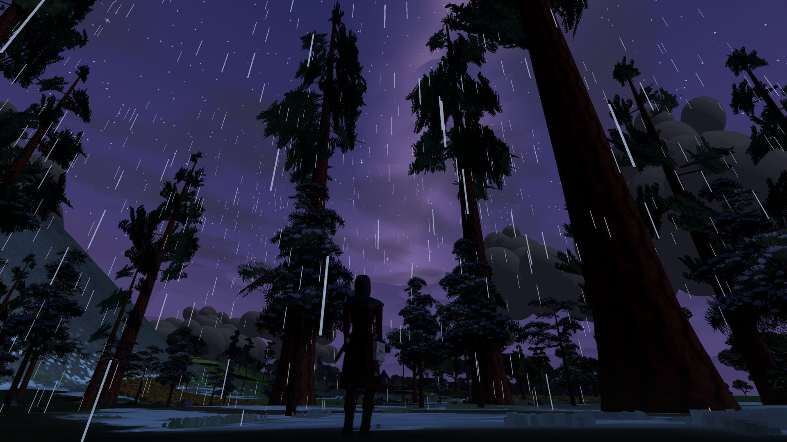
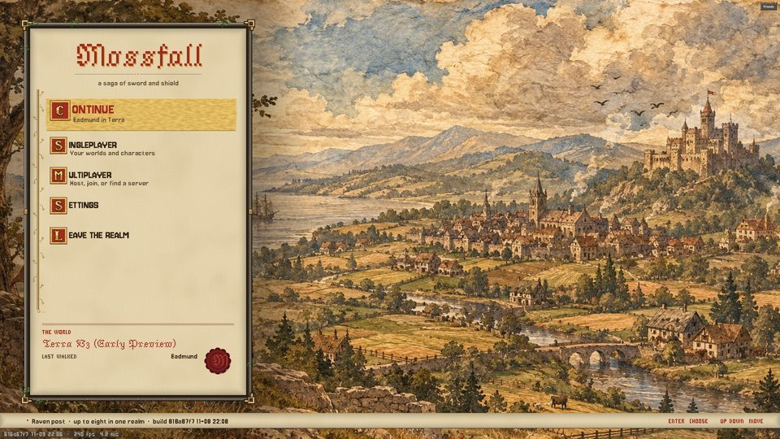
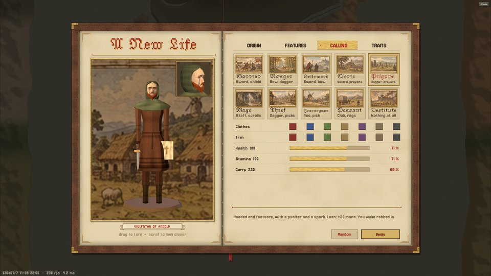
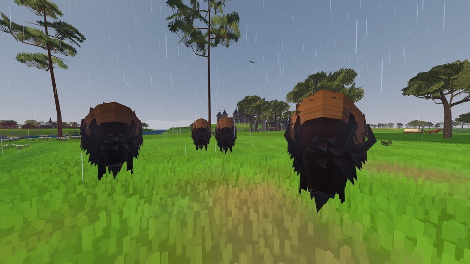
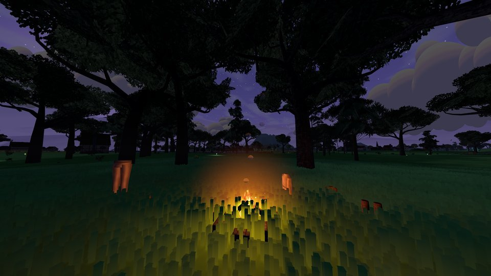
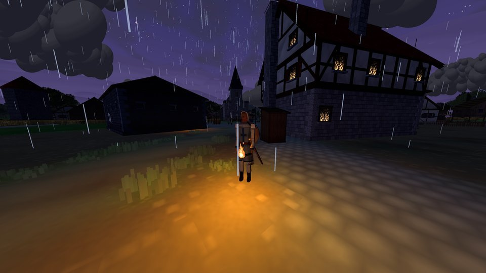
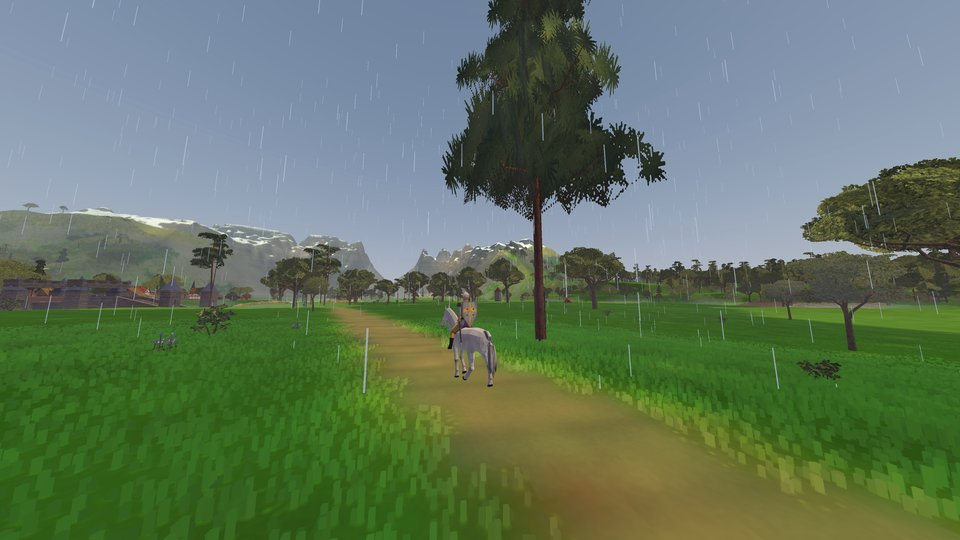
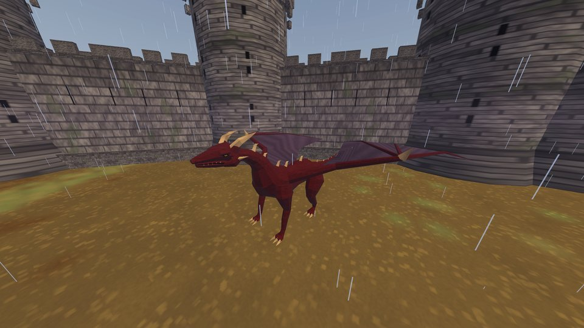
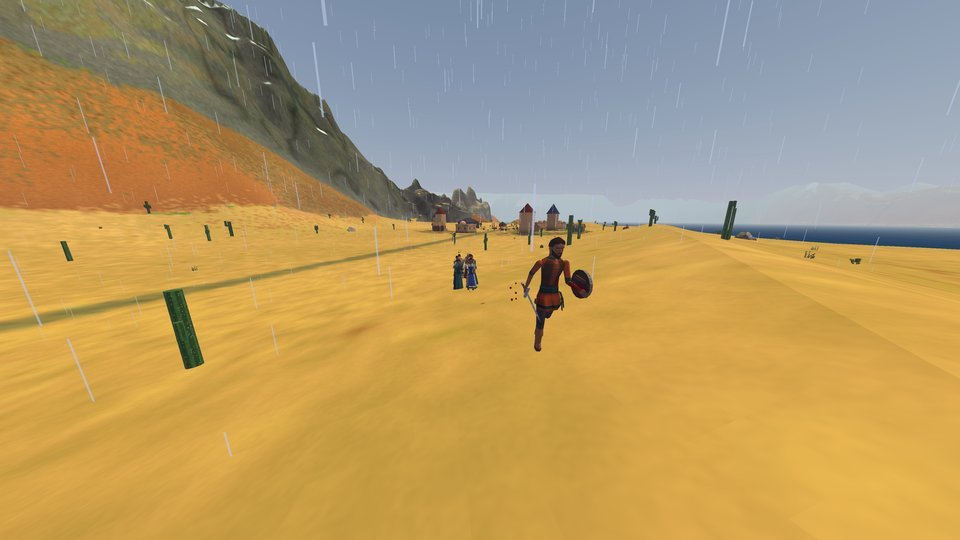

# Mossfall and the Ashcroft Labs playtest downloads

**Mossfall is a medieval first-person RPG set in one large world, played alone or with friends.**

This repository holds playtest builds of Ashcroft Labs games and the Ashcroft Labs launcher. It contains no source code. Mossfall is in active development, so expect rough edges, and thank you for trying it.

## A look at the world

| | |
|---|---|
|  |  |
| The title page. | Choosing a class and traits for a new life. |
|  |  |
| Bison graze the grassland in herds. | A night camp under the trees. |
|  |  |
| A town at night, torch in hand. | On the road toward the mountains. |
|  |  |
| A dragon in a castle yard. | The dry coast of Iboria in the south. |

## What you can do today

- **Live a life in Terra:** one world, one game. It is the same whether you play solo, host friends or join a dedicated server.
- **Skills:** learn trades and crafts, each with its own station and items.
- **Classes and traits:** your class comes from what you wear and carry, and you shape your character with traits at the start.
- **Magic:** learn spells, carry them in memory and cast them from the spell wheel.
- **Clothing:** shirts, trousers and robes are real equipment, and every trade has its own dress.
- **Towns and inns:** visit towns, rest at inns and meet the people who live there.
- **Megafauna:** meet bison, wolves, dragons and more across the land.
- **Co-op:** play with up to 8 friends.

## Download and play

1. Download **Ashcroft-Launcher_…_x64-setup.exe** from the [launcher release](https://github.com/ashcroft-labs/playtest/releases/tag/launcher) and run it.
   - The installer isn't code-signed yet, so Windows may show **"Windows protected your PC"**. Click **More info**, then **Run anyway**. You only see this once.
2. Open **Ashcroft Launcher**, go to **Games**, pick **Mossfall** and click **Add to library**. It installs and you can press **Play**.
   - Vegas RS needs your own copy of **Fallout: New Vegas** (for example from Steam). The launcher finds it automatically.

The launcher keeps itself and your games up to date.

## Something went wrong?

Press **F11** in the game to report a problem. It captures what you were doing and files it for us. A short note on what you expected is the most helpful thing you can add.
